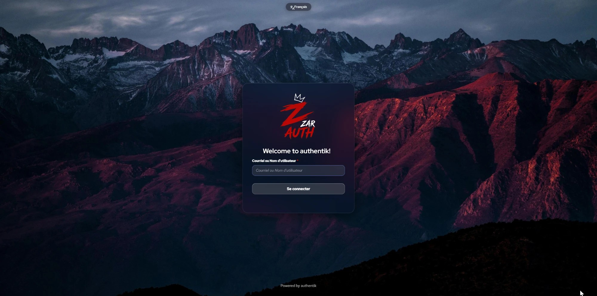
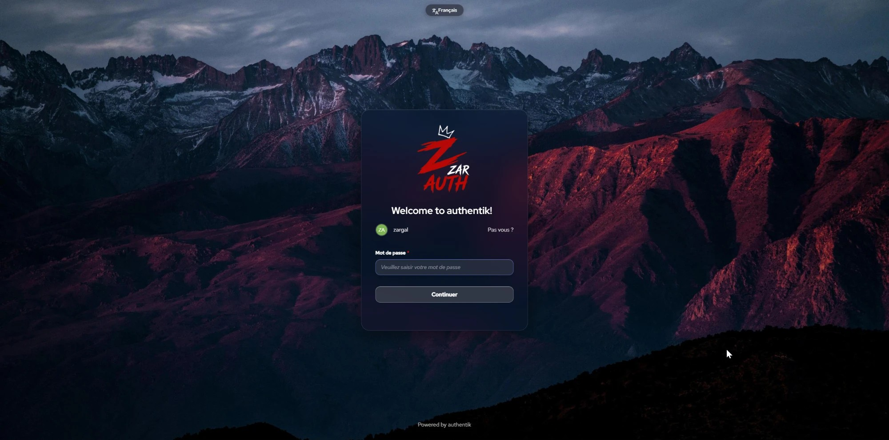
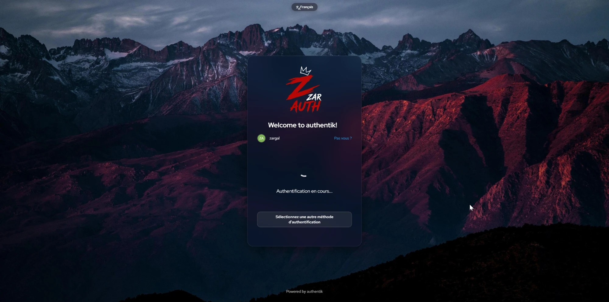
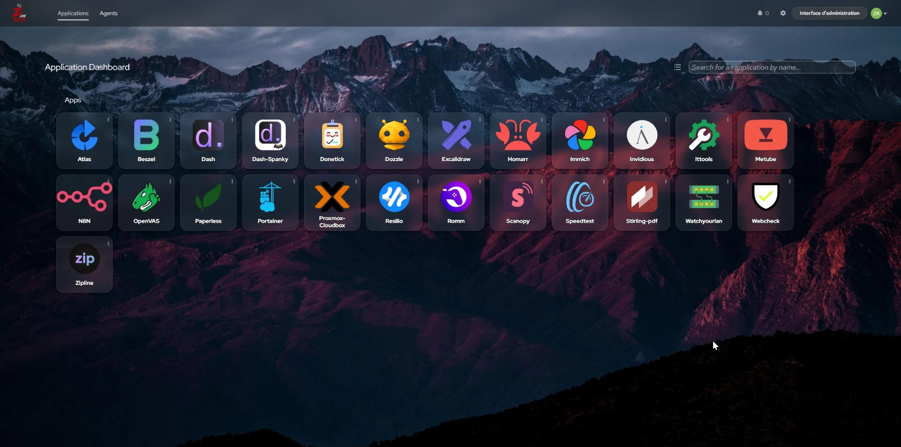
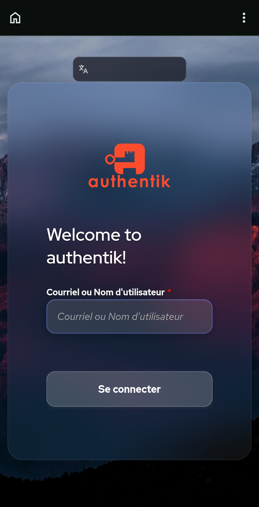
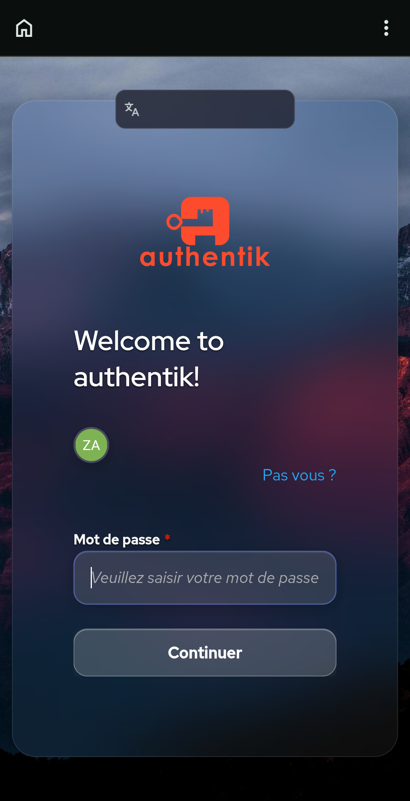
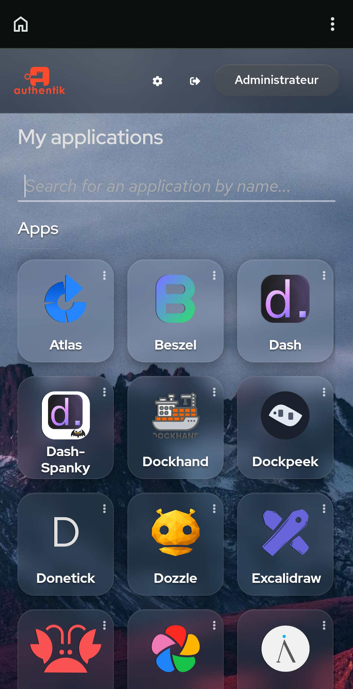
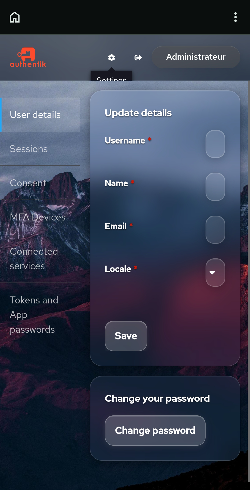

# Authentik Login-theme: Glassmorphism ✨ (2026.x fork)

A custom **glassmorphism** login theme for [Authentik](https://goauthentik.io/).

> ✅ **V4.0** — Rebuilt for **Authentik 2026.8.x** (validated against the 2026.8.4 frontend sources), desktop + tablet + mobile
>
> Forked from the original [VULGA01/Authentik-Login-theme-Glassmorphism](https://github.com/VULGA01/Authentik-Login-theme-Glassmorphism) (tested on 2025.10.3) and updated for the new Shadow DOM architecture introduced in Authentik 2026.x.

[](LICENSE)


## 📸 Previews

### 🖥️ Desktop

#### Login — Identification


#### Login — Password


#### Login — MFA (WebAuthn)


#### Application Dashboard


### 📱 Mobile

<table>
  <tr>
    <td align="center">
      <strong>Login — Identification</strong><br>
      
    </td>
    <td align="center">
      <strong>Login — Password</strong><br>
      
    </td>
  </tr>
  <tr>
    <td align="center">
      <strong>Application Dashboard</strong><br>
      
    </td>
    <td align="center">
      <strong>User Settings</strong><br>
      
    </td>
  </tr>
</table>

## ✅ Compatibility

| Authentik version | Status | Notes |
|---|---|---|
| **2026.8.x** | ✅ Supported | This fork — V4.0 |
| 2026.5.x | 🟢 Likely OK | Same flow executor grid |
| 2026.2.x | 🟡 Use V3.1.3 (tag/commit `98e26aa`) | Older executor layout |
| 2025.10.3 | 🟡 Use V3.0 from [original repo](https://github.com/VULGA01/Authentik-Login-theme-Glassmorphism) | Older DOM structure |
| ≤ 2025.x earlier | 🟡 Use V3.0 from [original repo](https://github.com/VULGA01/Authentik-Login-theme-Glassmorphism) | Older DOM structure |

## ✨ Features (V4.0)

- **Modern glassmorphism design** — `backdrop-filter` blur, semi-transparent glass cards, elegant shadows.
- **Full responsiveness** — Optimized for desktop, tablet, and mobile (including iOS quirks).
- **Authentik 2026.x Shadow DOM support** — Targets new components via CSS Shadow Parts:
  - `<ak-flow-card>` — new wrapper around every login stage
  - `<ak-form-static>` — avatar + username block
  - `<ak-flow-input-password>` — new password wrapper
  - `<ak-locale-select>` — language picker
  - `<ak-tabs vertical>` — vertical tabs in user settings
  - `<ak-empty-state>` — loading states
  - `pf-m-block` / `pf-m-icon` button/input variants
- **Works *with* Authentik's native login grid** — the card is centred by Authentik's own CSS grid; the theme only re-tunes its variables. Long forms scroll normally on phones.
- **Background on every viewport** — Authentik 2026.x hides the flow background under 560px; the theme keeps it.
- **Glass language picker** — centred pill on top, glass dropdown (customizable `<select>` on Chromium 135+, dark native popup elsewhere).
- **Sidebar layouts supported** — `sidebar_left` / `sidebar_right` flows get a full-height glass panel.
- **Only "Powered by authentik" hidden** — your own Brand footer links stay visible.
- **Phone friendly** — 16px inputs (no iOS zoom), 44px touch targets, logo shrinks on short/landscape screens, `prefers-reduced-motion` honoured.
- **User settings + dashboard theming** — Tabs, tables, app cards consistent glass styling.
- **Themed app card actions** — The `⋮` dropdown menu on each app is glass-styled.
- **Static error pages** — "Client ID Error" and other static error pages also themed.
- **Admin panel safe** — no global button/input rules any more; the admin interface is untouched.
- **Easy customization** — CSS variables at the top of `theme.css` (background, card width/opacity/radius, logo size, colours).

## 🚀 Installation

1. Clone or download this repository (or just grab `theme.css`).
2. In Authentik Admin Interface, go to:
   **Admin → System → Brands → Choose your brand → Brand settings → Custom CSS**
3. Paste the contents of `theme.css` into the Custom CSS field.
4. Save and refresh the login page (Ctrl+Shift+R for hard refresh).

## 🎨 Customization

Open `theme.css` and edit these variables at the top:

```css
:root {
    --ak-flow-background: url(https://your-image.jpg);     /* Background image */
    /* or reuse the flow background set in Authentik: */
    /* --ak-flow-background: var(--ak-global--background-image); */
    --ak-social-separator-text: "Continuer avec";          /* Separator text */
    --ak-accent: #d0ced0;                                  /* Accent color */
    --glass-card-width: 30rem;                             /* Login card max width */
    --glass-card-bg: rgba(15, 20, 35, 0.55);               /* Card tint / opacity */
    --glass-card-radius: 24px;                             /* Card corners */
    --glass-logo-size: 220px;                              /* Max logo box (square) */
}
```

You can also use a local image by hosting it on your Authentik instance (e.g. via
`/static/dist/assets/images/...`) and pointing the variable to that URL.

## ⚠️ Cloudflare Notice

If you're using **Cloudflare** with a **proxied domain**, you might experience issues
due to cached CSS. 👉 **Purge your Cloudflare cache** to ensure changes take effect.

## 🐛 Known Limitations

- The glass language dropdown needs a Chromium 135+ browser (`appearance: base-select`);
  Firefox/Safari show a dark native popup instead.
- The `<datalist>` autocomplete dropdown of the app search bar is browser-rendered.
- `backdrop-filter` is unavailable on some old browsers / Linux GPU setups: the card then
  falls back to a more opaque tint automatically.

## 📜 Changelog

See [CHANGELOG.md](./CHANGELOG.md) for the full version history.

### Summary of V4.0 vs V3.1.x

- 🔴 **Login layout rebuilt** for 2026.8: no more `position: fixed` card / `overflow: hidden` on `html, body` (card was pushed off-centre and long forms could not scroll on mobile).
- 🟢 Merged upstream fixes from VULGA01 (2026.2 / 2026.5: logo size, background-wrapper overlay, glass locale picker) and community forks.
- 🟢 Social buttons re-targeted to the 2026.x `<fieldset name="login-sources">`.
- 🟢 ~3200 → 1853 lines, every selector checked against the 2026.8.4 sources.

### Summary of V3.1.x vs V3.0

- 🔴 **Bugs fixed**: 3 invalid `:contains()` rules + 1 broken CSS block + brace imbalance
- 🟠 **Dead code removed**: 9 duplicate rule groups, 4 non-existent host selectors
- 🟢 **2026.x components added**: ~25 new `::part()` routes for new Shadow DOM components
- 🟢 **Static error pages themed** (Client ID Error, Permission Denied, etc.)
- 🟢 **CSS variables at `:root`** to pierce shadow boundaries (form controls, tables, tooltips)
- 🟢 **Stats**: 2273 → ~3180 lines · brace balance 180/182 ❌ → 266/266 ✅

## 🧑‍🎨 Credits

- **Original theme**: designed by [**VULGA**](https://github.com/VULGA01) — see the [original repository](https://github.com/VULGA01/Authentik-Login-theme-Glassmorphism).
- **2026.x compatibility fork**: maintained here with audit, cleanup, and new Shadow DOM component support.
- **Community forks merged in V4.0**: [PloxPlox](https://github.com/PloxPlox/Authentik-Login-theme-Glassmorphism) (user UI background), [WaYyTempest](https://github.com/WaYyTempest/Authentik-Login-theme-Glassmorphism) (app icons), [Anthony6444](https://github.com/Anthony6444/authentik-glassmorphism) (slant/locale), [sudoBrandino](https://github.com/sudoBrandino/Authentik-Login-theme-Glassmorphism) (vendor prefixes).

## 🔓 License

This project is open source and freely available under the **MIT License** (inherited
from the original). You can **use, share, and modify** it without restriction.

---

> Original work by [VULGA](https://github.com/VULGA01) ❤️ — 2026.x fork maintained for community.
